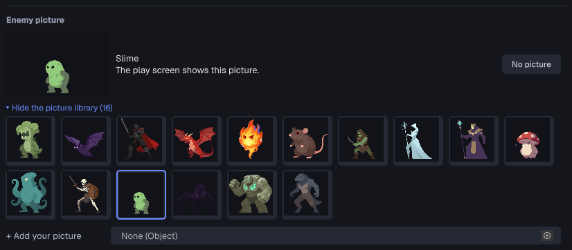

# Art library

Pictures for cards, relics, enemies, heroes, events and battle backgrounds come from art libraries. The maker ships a default library, and you add your own sprites or prefabs to a project library with the **+** field. Every picker lists the pictures of both libraries in one grid.

Pictures are presentation only. The engine, saved runs and the content fingerprint never see them, so changing a picture never blocks continuing a saved run.

## Where pictures are chosen

There is no separate window. Each editor has a picture section:

| Editor | Section title | Used for |
|---|---|---|
| [Card Editor](cards.md) | **Card picture** | Card illustration |
| [Relic Editor](relics.md) | **Relic icon** | Relic icon |
| [Enemy Editor](enemies.md) | **Enemy picture** | Enemy in combat |
| [Hero Editor](heroes.md) | **Hero picture** | Hero |
| [Event Editor](events.md) | **Event picture** | Event room |
| [Run Rule Editor](run-rules.md), area **Map and ? rooms** | **Battle background — Act 1** to **Act 4** | Background behind combat in each act |
| [Run Rule Editor](run-rules.md), area **Map and ? rooms** | **Start event picture** | The start event |

A card, relic, enemy, hero or event must be saved once before it can get a picture. Until then the section says "Create it first, then pick a picture."

## The picture section

| Control | Meaning |
|---|---|
| Current picture | A large preview, the picture name and a note: "The play screen shows this picture." or, with no picture, "The play screen shows only the panel." A picture whose entry was removed shows "Missing picture: ..." |
| **No picture** | Clears the choice. |
| **▸ Choose another picture** / **▾ Hide the picture library** | Opens or folds the thumbnail grid. The number in brackets is how many pictures of this kind exist. The grid is open while nothing is chosen. |
| Thumbnail grid | Every picture of this kind from all of the project's libraries. Hover a thumbnail to see its name and library. Click it to choose it; the chosen one has a coloured border. |
| **+ Add your picture** | Drop or pick a sprite, a texture or a prefab. It joins the project's own library and is chosen for this content at once. |

A choice is saved immediately into the project's last content pack; no **Save** is needed. The status box confirms it, for example `"<id>" uses <picture> (saved in pack "<pack>").`

If the project has no content pack, the controls are disabled and the section says "Add a content pack to the project to choose pictures."

## Adding your own pictures

1. Import your image or prefab into the Unity project (anywhere under `Assets`).
2. In the picture section, drag it onto **+ Add your picture** (or click the field and pick it).

What happens:

- A texture that is not imported as a sprite is switched to a single sprite with alpha transparency.
- A prefab must be a prefab asset from the Project window, not a scene object.
- On first use the maker creates the project library `ProjectArtLibrary.asset` in an `Art` folder next to the project asset and adds it to the project.
- Adding the same sprite or prefab again for the same kind reuses its entry.

Prefab pictures are drawn on the play screen through a render texture without extra lighting, so unlit or sprite-based prefabs give the best result. A sprite is used directly.

## Default art library

The default library is in `Assets/DeckForge/ArtLibrary/Default`. It holds 105 pictures:

| Kind | Pictures |
|---|---|
| Cards | 59 |
| Enemies | 16 |
| Relics | 18 |
| Events | 5 |
| Heroes | 4 |
| Battle backgrounds | 3 |

The enemy, card and relic templates in the editors use pictures from this library. A project that does not list the default library gets it added automatically when a picture section opens. The default library's pictures are not edited from the maker windows.

## Asset types

You can create an extra library with **Assets > Create > Roguelike Deckbuilder Maker > Art Library** and add it to the project's **Art Libraries** list in the project asset.

**Art Library** fields:

| Field | Meaning |
|---|---|
| **Library Id** | Unique ID, generated on creation. Packs store pictures as `library/entry`, so two libraries may reuse entry IDs. |
| **Display Name** | Name shown in thumbnail tooltips. |
| **Is Default** | Marks the library that ships with the maker. Leave it off for your own libraries. |
| **Entries** | The pictures. |

Each entry:

| Field | Meaning |
|---|---|
| **Id** | Entry ID, unique within the library. |
| **Kind** | Enemy, Card, Relic, Hero, Background or Event. Pickers show only entries of their kind. |
| **Display Name** | Name shown in the picker. |
| **Sprite** | The thumbnail and the play screen picture. |
| **Prefab** | Optional prefab picture. Used when there is no sprite. |

## Checks

- Deleting a card, relic or enemy in its editor also removes its picture choice.
- A picture choice in a later content pack wins over an earlier one.
- If a picture shows "Missing picture", choose another one or **No picture**.

## Related pages

- [Cards](cards.md)
- [Relics](relics.md)
- [Enemies](enemies.md)
- [Heroes](heroes.md)
- [Sound and effects](sound-effects.md)
