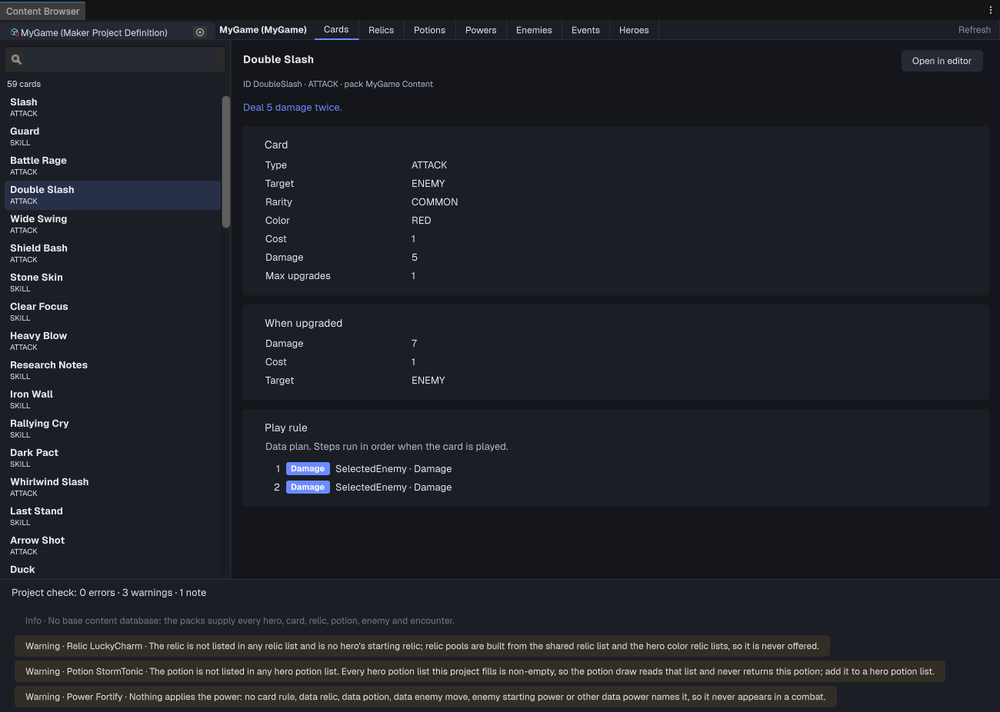

# Content Browser

The Content Browser is a read-only view of everything the project composes: cards, relics, potions, powers, enemies, events and heroes. Use it to search the whole project, read an entry's values and see every project check result. It does not change any asset.

Open it from **Tools > Roguelike Deckbuilder Maker > Content Browser**, or press **Open Content Browser** in the [Project Overview](project-overview.md).

## Layout

| Area | What it shows |
|---|---|
| Project field (toolbar) | The maker project to browse. With no project chosen the list is empty and a note says how to make one. |
| Source label | The project name, and the number of packs when there are several. |
| Kind tabs | **Cards**, **Relics**, **Potions**, **Powers**, **Enemies**, **Events**, **Heroes**. |
| **Refresh** | Reads the project again. |
| Search field | Filters the list by name, ID or category. |
| Entry list | One row per entry: its name, then a grey line with the ID (when it differs from the name), the category and, in a multi-pack project, the pack it comes from. |
| Detail pane | The selected entry's fields grouped in sections. |
| **Validation** panel | Every project check result. |

## Read an entry

Select a row. The detail pane shows:

- the entry's name, its ID, its category and the pack it comes from;
- its description, when it has one;
- its fields, grouped in foldable sections;
- for a card, a **Play rule** section that lists the steps the card runs when played, one row per step.

Field values are selectable, so you can copy an ID from them.

Press **Open in editor** to open the editor window for the entry: the Card, Relic, Potion, Enemy, Event or Hero editor. A built-in power has no editor, so the Power Editor opens on its new-power form for it.

A card whose play rule is missing shows a **NO RULE** badge. The project refuses such a card when it composes or plays; open it in the [Card Editor](cards.md) and give it steps.

## Validation panel

The panel title sums up the check, for example "Project check: 0 errors · 1 warning · 4 notes". It opens by itself only when there is an error or a warning.

Each result is a button: **Level · Kind ID · message**. Press a result that names an entry to switch to its tab and select it. The panel shows every result, while the Project Overview shows up to 50 per table.

## Workflow

1. Pick the tab of the content kind you want.
2. Type part of a name or ID in the search field.
3. Select the entry and read its values and steps.
4. Press **Open in editor** to change it.
5. After saving, press **Refresh** and check the **Validation** panel.

## Related pages

- [Project Overview](project-overview.md)
- [Cards](cards.md)
- [Relics](relics.md)
- [Potions](potions.md)
- [Powers](powers.md)
