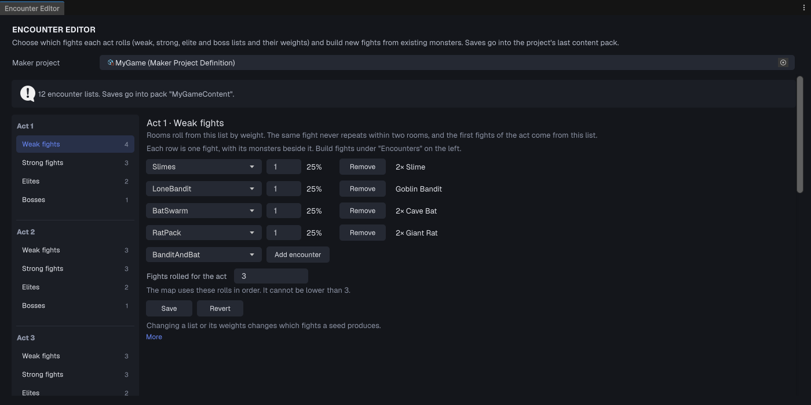
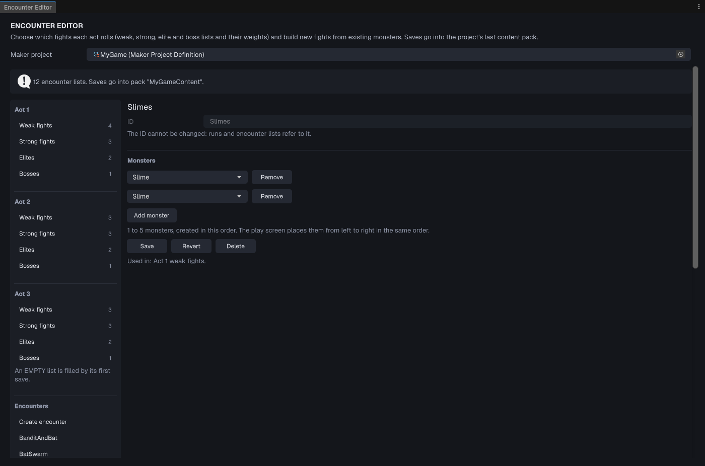

# Encounters

An encounter is one fight: a list of 1 to 5 enemies. The Encounter Editor builds encounters from your enemies and decides which encounters each act rolls for weak fights, strong fights, elites and bosses.

## Open the editor

Menu: **Tools > Roguelike Deckbuilder Maker > Encounter Editor**

Select the project in the **Maker project** field. Saves go into the project's last content pack.

The left column has two parts:

- **Act 1** to **Act 3**, each with four lists: **Weak fights**, **Strong fights**, **Elites** and **Bosses**. Each row shows how many encounters the list holds. A list marked **EMPTY** does not exist yet and is created by its first save.
- **Encounters**: the **Create encounter** button and the project's encounters by ID.

## Workflow

1. Make the enemies first in the [Enemy Editor](enemies.md). Only enemies built from moves and rules can be placed in an encounter.
2. Click **Create encounter**, type an **ID**, pick the monsters, and click **Save**.
3. Select a list on the left (for example Act 1 · Weak fights), pick the encounter in the popup next to **Add encounter**, click **Add encounter**, set its weight, and click **Save**.
4. Repeat for every list that a run needs. Restart a Play Preview session to use the change.

## Encounter form

| Control | Meaning |
|---|---|
| **ID** | Names the fight in encounter lists and saves. It cannot be changed after the first save, and it cannot start with `elite:`. |
| Monster rows | One popup per monster, listing the project's enemies by name and ID. **Remove** deletes a row. |
| **Add monster** | Adds a monster (up to 5). |
| **Save** | Saves the encounter. |
| **Revert** | Discards unsaved changes. |
| **Delete** | Deletes a saved encounter. Refused while a list uses it. |

Monsters are created in list order, and the play screen places them from left to right in the same order. Under the buttons, the form shows the lists that use the encounter, or a note that it is not in any list yet.

## List form

| Control | Meaning |
|---|---|
| Encounter popup | The encounter of this row. |
| Weight | How often the row is rolled relative to the others (not shown for bosses). The percentage next to it is the row's share of the total. |
| **Remove** | Removes the row. |
| **Add encounter** | Adds the encounter chosen in the popup next to it with weight 1. |
| **Fights rolled for the act** | How many fights the map rolls from this list for the act, used in order (not shown for bosses). |
| **Save** / **Revert** | Saves or discards the list. |

How each list is used:

| List | Rule |
|---|---|
| **Weak fights** | Rooms roll by weight. The same fight never repeats within two rooms, and the first fights of the act come from this list. |
| **Strong fights** | Rooms roll by weight. The same fight never repeats within two rooms, and some strong fights are skipped right after a related weak fight. |
| **Elites** | Elite rooms roll from this list. The same elite never appears twice in a row. |
| **Bosses** | One boss is picked for the act. Bosses the player has not met yet come first; otherwise the list is shuffled. |

Changing a list or its weights changes which fights a seed produces. An encounter keeps its own monsters and HP, so an Act 1 fight placed in Act 3 stays as strong as in Act 1.

## Validation

The editor checks the whole project before it saves. If a check fails the status box shows `Not saved:` with the reason and nothing is written.

| Rule | Limit |
|---|---|
| Monsters per encounter | 1 to 5 |
| Encounters per list | at least 3 different ones for weak and strong fights, 2 for elites, 1 for bosses |
| Weight | greater than zero (weak, strong, elite) |
| Same encounter twice in one list | not allowed |
| **Fights rolled for the act** | Weak: at least 3 in Act 1 and 2 in Acts 2 and 3. Strong: at least 12. Elites: at least 10. At most 105. |
| Encounter ID | must be unique ("The ID ... is already used by another encounter.") |

## Tips

- Fill the four lists of every act a run reaches before a full playtest, then check the result in [Play Preview](../playtesting/play-preview.md).
- Give the same encounter different weights in different acts to make it rarer later.
- Use the encounter usage note to find which lists to edit before you delete an encounter.

## Related pages

- [Enemies](enemies.md)
- [Events](events.md) (an event step can start one of your encounters)
- [Run rules](run-rules.md) (map room chances)
- [Run flow](../concepts/run-flow.md)
