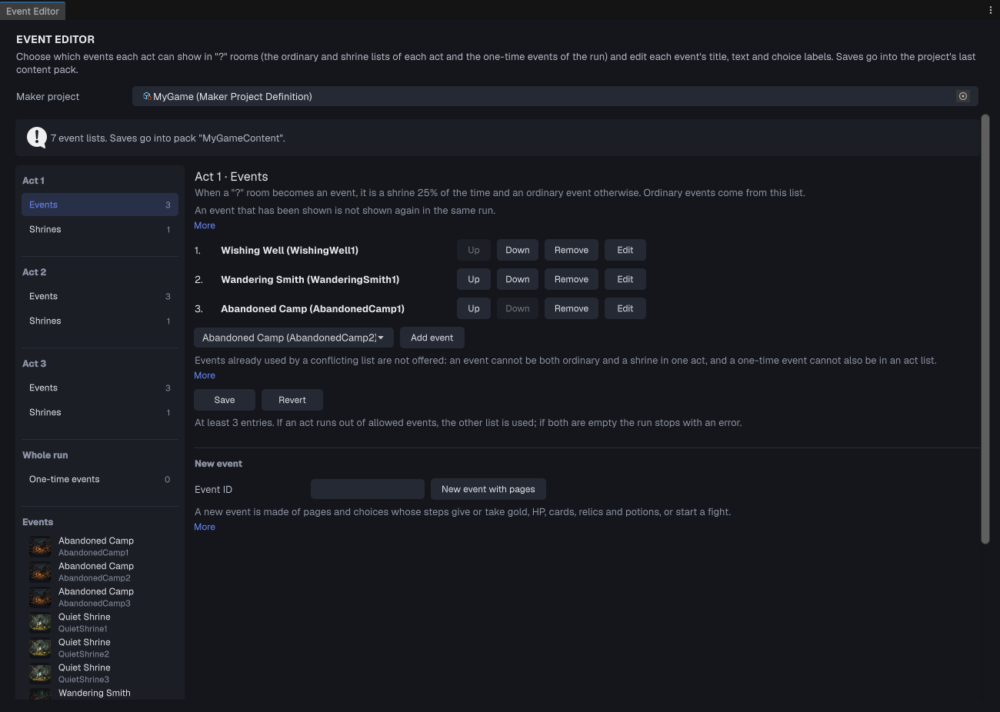
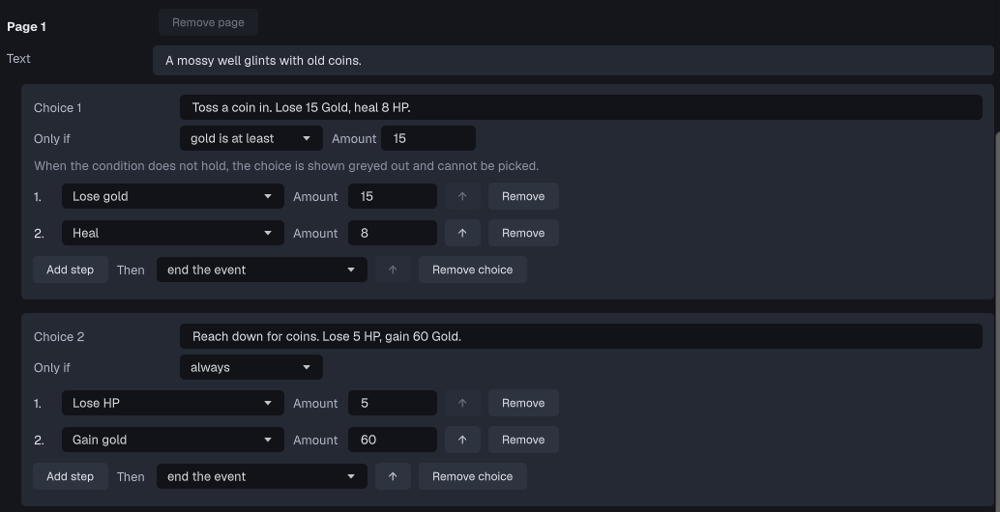

# Events

Events appear in "?" rooms on the map. The Event Editor builds events out of pages and choices, and decides which events each act can show.

## Open the editor

- Menu: **Tools > Roguelike Deckbuilder Maker > Event Editor**
- From the [Content Browser](content-browser.md): open an event entry.

Select the project in the **Maker project** field. Saves go into the project's last content pack.

The left column lists:

- **Act 1** to **Act 3**, each with two lists: **Events** (ordinary events) and **Shrines**.
- **Whole run**: **One-time events**.
- **Events**: the project's events by name.

A list marked **EMPTY** does not exist yet and is created by its first save.

## Workflow

1. Select the list the event should join first (for example Act 1 · Events).
2. Under **New event**, type an **Event ID** and click **New event with pages**. The new event starts with one page and one choice that gives 50 gold and ends the event, and its list is ticked under **Where it appears**.
3. Edit the title, pages, choices and steps.
4. Click **Create event**. The event is saved and added at the end of every ticked list.
5. After the first save, choose a picture in the **Event picture** section.
6. Restart a Play Preview session to use it.

To change an existing event, select it under **Events**, or press **Edit** on its row in a list.

## Event lists

| Control | Meaning |
|---|---|
| Rows | The events of the list, numbered in order. |
| **Up** / **Down** | Move a row. The order matters: an event is picked by position among the allowed candidates, so moving a row changes which event a seed produces. |
| **Remove** | Removes the event from this list. |
| **Edit** | Opens the event. |
| **Add event** | Adds the event chosen in the popup next to it. |
| **Save** / **Revert** | Saves or discards the list. |

How the lists work:

| List | Rule |
|---|---|
| **Events** | When a "?" room becomes an event, it is a shrine 25% of the time and an ordinary event otherwise. Ordinary events come from this list. The shrine share is the **Chance an event room draws from the shrine pool** rule in the [Run Rule Editor](run-rules.md). |
| **Shrines** | Shrine rolls pick from this list together with the one-time events that are currently allowed. |
| **One-time events** | Join the shrine candidates of every act. This list is set once per run and is not refilled between acts. |

An event that has been shown is not shown again in the same run. An event cannot be both ordinary and a shrine in one act, and a one-time event cannot also be in an act list; the popup does not offer events that would conflict. If an act runs out of allowed events, the other list is used; if both are empty the run stops with an error.

## Event form

| Control | Meaning |
|---|---|
| **Back to the list** | Returns to the selected list. |
| **Event picture** | Picture shown with the event. See [Art library](art-library.md). |
| **Where it appears** | Seven toggles: **Act 1 · Events** to **Act 3 · Events**, **Act 1 · Shrines** to **Act 3 · Shrines**, and **One-time events (whole run)**. A ticked list gets the event at its end; an event in no list never appears. |
| **Title** | The event title. |
| **Leave button** | The button shown after a choice ends the event; pressing it returns to the map. |
| **Add page** | Adds a page with one **Continue** choice. |
| **Create event** / **Save** | Saves the event and its list membership. |
| **Discard** / **Revert** | Drops a new event or discards unsaved changes. |
| **Delete event** | Asks for confirmation, then deletes the event from the pack and from every event list. |

### Pages and choices

The run opens page 1. Each page has a **Text** field, its choices, and **Remove page** (disabled while it is the only page).

| Choice control | Meaning |
|---|---|
| **Choice N** | The button text. |
| **Only if** | A condition. When it does not hold, the choice is shown greyed out and cannot be picked. |
| Steps | What the choice does, in order. **Add step** adds one; **↑** and **Remove** edit the list. |
| **Then** | "end the event" or "open page N". |
| **↑** / **Remove choice** | Reorder or delete the choice. |
| **Add choice** | Adds a **Leave** choice to the page. |

Conditions for **Only if**:

| Condition | Value |
|---|---|
| always | none |
| gold is at least | **Amount** |
| HP is at least | **Amount** |
| the deck has a card to upgrade | none |
| the deck has a removable curse | none |
| the player has relic | a relic |
| the act is at least | **Act** (1–3) |

### Steps

| Step | Fields |
|---|---|
| **Gain gold** / **Lose gold** | **Amount** |
| **Lose HP** / **Heal** | **Amount** |
| **Raise max HP** / **Lower max HP** | **Amount** (at least 1) |
| **Obtain a card** | a card, **Upgraded** |
| **Obtain a random card** | rarity (COMMON, UNCOMMON, RARE, or "any rarity (rolled)"), **Upgraded** |
| **Obtain a curse** | a curse card, or "(rolled curse)" |
| **Remove a card (player picks)** | none |
| **Upgrade a card (player picks)** | none |
| **Transform a card (player picks)** | none |
| **Obtain a relic** | a relic |
| **Obtain a random relic** | tier (COMMON, UNCOMMON, RARE, SHOP, BOSS, or "any tier (rolled)") |
| **Obtain a random potion** | none |
| **Start a fight** | an encounter, **Elite**, **No rewards** |

The card list for **Obtain a card** leaves out curse and status cards. **Start a fight** lists the encounters made in the [Encounter Editor](encounters.md).

## Copy an event

Select a saved event, type an ID in **New event ID** under **Make a new event from this one**, and click **Copy as new event**. The copy keeps the pages, choices, outcomes and lists. Press **Create event** to save it.

## Validation

Problems appear live in a red box under the pages, and **Create event** / **Save** refuse while any remain.

| Rule | Limit |
|---|---|
| Event ID | 1–64 letters, digits, spaces, hyphens, underscores or apostrophes, starting with a letter or digit; must not already exist |
| Pages | 1 to 4; every page must be reachable from page 1 |
| Choices per page | 1 to 4; each needs text; each page needs at least one choice with no condition |
| Steps per choice | 0 to 6 |
| Amounts | 0 to 999 (max HP steps 1 to 999) |
| Card choice and fight steps | Removing, upgrading or transforming a card and starting a fight must be the last step of the choice |
| Fight steps | A fight always ends the event, so its choice must not open a page |
| Leave button | must not be empty |
| List sizes | Events: at least 3 entries. Shrines: at least 1. One-time events: may be empty. |

## Saves and continue

A saved run that is inside an event continues on the saved pages. Deleting the event makes such a run unable to continue. See [Saves and continue](../playtesting/saves-continue.md).

## Tips

- Keep one plain "leave" style choice on every page so the player can always move on.
- Put a choice that hands the run to another screen (card selection or a fight) last in its step list.
- Use **Then: open page N** to build short branching stories without extra events.

## Related pages

- [Encounters](encounters.md)
- [Run rules](run-rules.md)
- [Art library](art-library.md)
- [Run flow](../concepts/run-flow.md)
