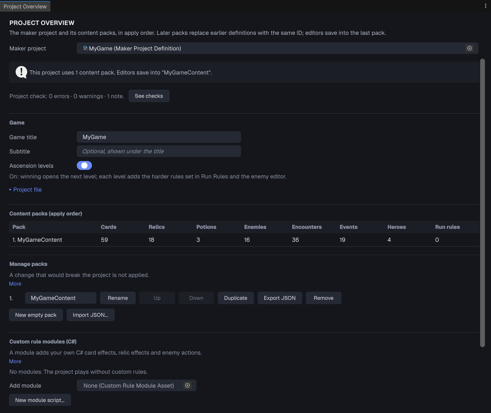
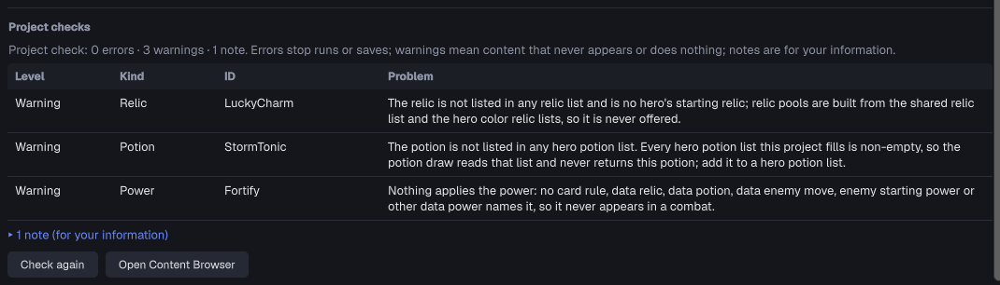

# Project Overview

The Project Overview is the first window of the maker. It shows the selected maker project, its game title and options, its content packs in apply order, its custom rule modules and the result of the project check.

Open it from **Tools > Roguelike Deckbuilder Maker > Project Overview**. **New Project...** and **Create Sample Project** also open it on the new project.

## Choose the project

Every maker window has a **Maker project** field at the top. It starts with the project selected in the Project window, the project that owns a selected content pack, or the first project asset found. Drag another project asset into the field to switch.

The status box under the header tells you how many content packs the project uses and which pack the editors save into. When the project does not compose, the box shows the error instead.

## Game

| Field | Meaning |
|---|---|
| **Game title** | The name the play screen's title shows. Saved on the project asset when you leave the field. |
| **Subtitle** | A short line under the title. Leave it empty for none. |
| **Ascension levels** | On: the title screen offers Ascension levels. Winning with a hero opens the next level, and each level adds the harder rules set in the Run Rule Editor (Asc N+ values) and in the Enemy Editor. Off: every run is a plain run and the title shows no Ascension row. |

Reopen the Game Screen or Player Screen to see a changed title or Ascension setting.

The **Project file** fold lists the asset name, asset path and **Project ID**. Saved runs and progress are kept per Project ID. When another project asset uses the same ID (a copied project usually does), the window warns you and offers **Give this project a new ID**. The current saves stay with the old ID.

## Content packs

A project is made of one or more content packs. Packs apply in order: a later pack replaces an earlier definition with the same ID. Every editor saves into the **last** pack in the list.

The **Content packs (apply order)** table counts the cards, relics, potions, enemies, encounters, events, heroes and run rules in each pack.

Under **Manage packs**, each pack has a row with these controls:

| Control | What it does |
|---|---|
| Name field and **Rename** | Type a new name, then press **Rename**. Renames the pack asset. |
| **Up** / **Down** | Moves the pack in the apply order. Saved runs made with the old order may no longer continue. |
| **Duplicate** | Inserts a copy after the pack with a new pack ID. |
| **Export JSON** | Writes the pack to a `.json` file. |
| **Remove** | Takes the pack out of this project. The asset file stays; **Edit > Undo** adds it back. |

Below the rows:

- **New empty pack** adds an empty pack at the end. Editors then save into it.
- **Import JSON...** reads a pack file and adds it as the last pack, saved as a new pack asset next to the project. If the file's pack ID is missing or already used in the project, the pack gets a new ID.

Every change to the pack list is first tried by composing the whole project, as a run would. A change that would break the project is not applied, and the status box shows why.

Pack files use the format `deckforge-content-pack`. This version of the maker reads pack file versions 1 to 5 and refuses a file made by a newer maker instead of dropping what it cannot read.

## Custom rule modules (C#)

This section lists the project's custom rule modules. A module adds your own C# card effects, relic effects and enemy actions; its rules then appear as **Run a custom rule (C#)** in the Card, Relic and Enemy editors.

| Control | What it does |
|---|---|
| **Select** | Selects and pings the module asset. |
| **Remove** | Removes the module from the project. Refused while a card, relic or enemy still uses one of its rules. Saved runs that recorded its rules can no longer continue. |
| Rule table | Each registered rule with its **Rule** ID, **Kind**, **Version** and **Name**. |
| **Add module** | Drop a module asset here to add it. It is kept only when its rules register and the project still composes. |
| **New module script...** | Writes a new C# module script from a template (same as **Tools > Roguelike Deckbuilder Maker > New Custom Rule Module...**). |

See [Custom rule modules](../extending/custom-rule-modules.md) for writing a module.

## Project checks

A line near the top of the window sums up the check, for example "Project check: 0 errors · 2 warnings · 3 notes". Press **See checks** to scroll to the **Project checks** section at the bottom.

- **Errors** stop runs or saves.
- **Warnings** mean content that never appears or does nothing.
- **Notes** are for your information and never stop a run. They wait in a closed fold.

Errors and warnings show in a table with the columns **Level**, **Kind**, **ID** and **Problem**. The window shows up to 50 rows per table; the [Content Browser](content-browser.md) lists all of them.

The check covers what composition lets through, for example:

- a missing library order table, or a card library entry that names no card;
- a card in the library whose rarity or color is never offered;
- a reward pool with too few cards to offer three different ones;
- a card step that resolves to 0 from the card's own values, or an X cost card whose X steps all depend on one upgrade state;
- a relic outside every relic list, or in a tier that is never drawn;
- a relic with more than one **Every Nth time** trigger (they share one counter) or more than one **Once per combat** trigger (only the first to fire runs);
- card name clashes and card creation chains that return to the same card;
- a project with no hero yet.

Press **Check again** after a fix, or **Open Content Browser** to look at the entries.

## Workflow

1. Create a project with **New Project...** or **Create Sample Project**.
2. Set **Game title** and **Subtitle**, and decide whether to use **Ascension levels**.
3. Keep your work in the last pack. Add a new empty pack when you want to keep a set of changes apart.
4. Edit content in the editors, then come back and read the project check.
5. Use **Export JSON** to move a pack to another project, and **Import JSON...** to bring it in.

## Related pages

- [Projects and content](../concepts/projects-and-content.md)
- [Content Browser](content-browser.md)
- [Run rules](run-rules.md)
- [Custom rule modules](../extending/custom-rule-modules.md)
- [Saves and continue](../playtesting/saves-continue.md)
