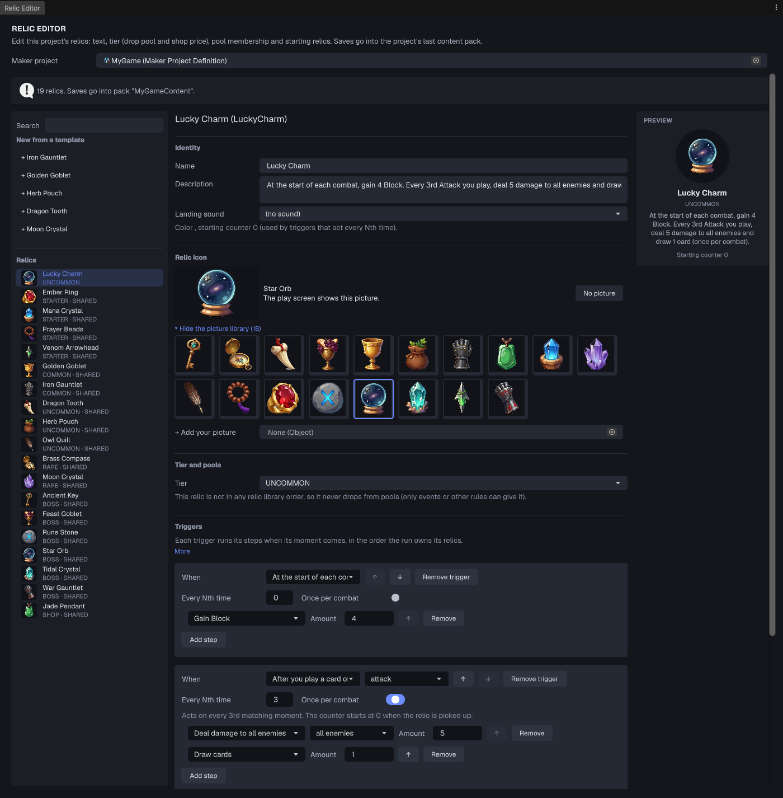
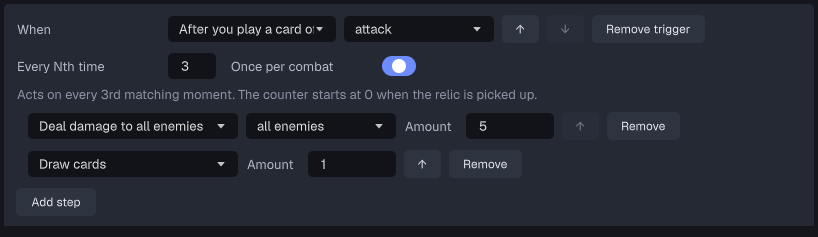

# Relics

The Relic Editor changes the project's relics and makes new ones. A relic acts through **triggers**: each trigger waits for a moment in the run (combat start, a card played, an enemy dying...) and then runs its steps. The editor also sets the relic's tier, drop table, icon, landing sound and starting relics. Saves go into the project's last content pack.

Open it from **Tools > Roguelike Deckbuilder Maker > Relic Editor**, or select a relic in the [Content Browser](content-browser.md) and press **Open in editor**.

## Layout

- **List** on the left: a **Search** field, the **New from a template** buttons and every relic of the project.
- **Form** in the middle.
- **Preview** on the right: the relic's icon on a round plate, its name, a tier line and its text, and its starting counter. It hides while the window is narrower than 1000 pixels.

Each list row shows the relic's icon (or a dot colored by tier when it has none), its name and a grey line with its tier and color. Type in **Search** to filter by name or ID.

## Create a relic

**From a template.** Press one of the **+** buttons under **New from a template**. The templates cover Block at combat start, gold when an enemy dies, healing after a won combat, damage to all enemies at combat start and energy on every third Attack played. Each comes with its triggers and a default icon. A template relic is shared by every hero and sits in its tier's drop pool. Press **Create relic** to add it; the template icon is assigned then.

**From an existing relic.** Select a relic. Under **Make a new relic from this one**, type a **New relic ID** and press **Copy as new relic**. The copy keeps the triggers, steps, numbers, tier, drop table and icon. Change it, then press **Create relic**.

A relic ID is 1 to 64 letters, digits, spaces, hyphens, underscores or apostrophes, starting with a letter or digit.

## Save, revert and delete

| Button | What it does |
|---|---|
| **Create relic** / **Save** | Composes the whole project with the change and writes it to the last pack. A refused composition writes nothing. |
| **Revert** | Drops the unsaved changes. |
| **Delete relic** | Deletes the relic after a confirmation. Refused while a hero starts with it. Its icon choice is removed with it. **Edit > Undo** restores it. |

Restart a Play Preview session to use a saved change.

## Identity

| Field | Meaning |
|---|---|
| **Name** | The relic's shown name. |
| **Description** | The relic's text (tooltip). Write it to match the triggers. |
| **Landing sound** | The sound when the relic lands in the relic bar after it is picked up. The list holds the sounds the project's relics use, or **(no sound)**. |

A note under the fields shows the relic's color and its starting counter, which triggers with **Every Nth time** use.

## Relic icon

The **Relic icon** section works like the card picture picker: press an icon in the grid, press **No picture** to clear it, or drop a sprite, texture or prefab into **+ Add your picture** to add your own. The choice is saved at once into the last pack. See [Art library](art-library.md).

## Tier and pools

| Field | Meaning |
|---|---|
| **Tier** | STARTER, COMMON, UNCOMMON, RARE, BOSS, SHOP or SPECIAL. The tier picks the drop pool and sets the shop price. |
| **In relic pools** | Whether the relic is in a drop table. Off: it never drops. |
| **Drop table** | Which table holds the relic: every hero, or one hero only. Shown when **In relic pools** is on. |

Only COMMON, UNCOMMON, RARE, SHOP and BOSS relics drop. A STARTER or SPECIAL relic stays out of the drop tables; make it a starting relic, or give it from an event with an "Obtain relic" step.

## Triggers

A relic has 1 to 4 triggers, and each trigger has 1 to 6 steps. Triggers run in the order the run owns its relics. Combat moments queue their steps in combat; **When picked up** and **After a won combat** only heal, give gold or raise max HP.

Each trigger box has:

| Control | Meaning |
|---|---|
| **When** | The moment the trigger waits for (see the table below). |
| Card type | Shown for **After you play a card of type**: any, attack, skill, power, status or curse. |
| **↑** / **↓** | Moves the trigger. |
| **Remove trigger** | Deletes the trigger. |
| **Every Nth time** | 0 or 1: every time. 2 or more: the relic's counter counts matching moments and the trigger acts on every Nth one (up to 20). The count is kept in saves. |
| **Once per combat** | The trigger runs at most once each combat. Not offered for **When picked up**. |
| **Add step** | Adds a step to the trigger. |

| When | Moment | Steps allowed |
|---|---|---|
| At the start of each combat | Combat begins. | Combat steps |
| At the start of your turn | The player's turn begins. | Combat steps |
| At the end of your turn | The player's turn ends. | Combat steps |
| After you play a card of type | The player plays a card of the chosen type. | Combat steps |
| When an enemy dies | An enemy dies. | Combat steps |
| After a won combat | A combat is won. | Heal, Gain gold, Raise max HP, custom rule |
| When picked up | The relic is obtained. | Heal, Gain gold, Raise max HP, custom rule |

Combat steps are: Deal damage to a random enemy, Deal damage to all enemies, Gain Block, Lose HP, Apply a power, Draw cards, Gain energy, Heal, Channel orbs, Change stance, Add cards to the hand, Add a card to the discard pile, Shuffle cards into the draw pile, Gain gold and Run a custom rule (C#).

## Steps

Each step is one row:

| Control | Meaning |
|---|---|
| Action dropdown | What the step does. |
| Key dropdown | The power, orb, stance or card the step names, when the action needs one. |
| **(card to create)** | For a power that adds a card each turn: the card it makes. Required; an empty choice is refused. |
| Target | The player, a random enemy or all enemies, when the action allows a choice. A relic has no chosen enemy. |
| **Amount** / **Count** | The step's number. **Count** for orbs and cards made. Not shown for Change stance. |
| **↑** | Moves the step up. |
| **Remove** | Deletes the step. |

A new step starts with a typical amount for its action, for example 6 Block or 15 gold.

**Run a custom rule (C#)** shows the project's relic rules and their value fields. Outside combat a custom relic rule may only heal, give gold or lose HP. See [Custom rule modules](../extending/custom-rule-modules.md).

An error box under the triggers lists every problem the relic would be refused for. It updates on every change.

## Starting relics

Pick a **Hero**. The note lists what that hero starts with. For a STARTER-tier relic, **Add to <hero>** or **Remove from <hero>** changes the hero's starting relics. Only STARTER relics can be starting relics: a run adds them without their pick-up effects. Save the relic first.

## Checks

- The error box under the triggers.
- "Not saved: ..." in the status box when a save is refused.
- The [Project Overview](project-overview.md) check warns about a relic outside every relic list, a relic in a tier that is never drawn, and relics with several **Every Nth time** or **Once per combat** triggers.

## Tips

- Use one counting trigger per relic: all **Every Nth time** triggers of a relic share its one counter.
- Use one **Once per combat** trigger per relic: only the first to fire runs.
- Keep the **Description** in step with the triggers; the editor does not write it for you.

## Related pages

- [Effects and powers](../concepts/effects-and-powers.md)
- [Powers](powers.md)
- [Heroes](heroes.md)
- [Events](events.md)
- [Art library](art-library.md)
- [Sound and effects](sound-effects.md)
