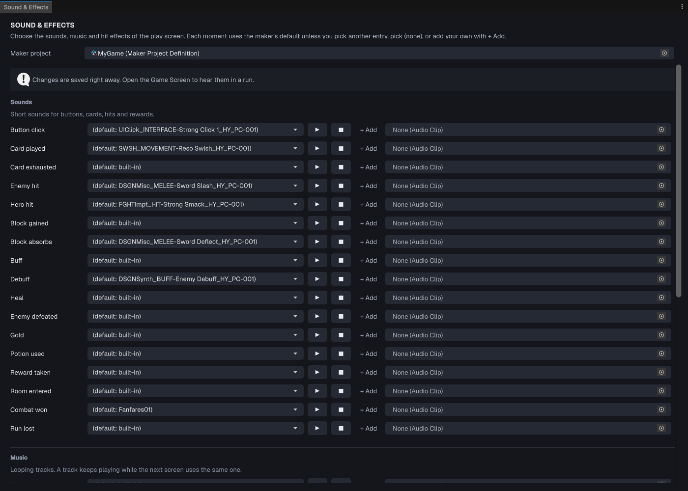

# Sound and effects

The **Sound & Effects** window chooses the sounds, music tracks and hit effects of the play screen. Each moment of the play screen is a slot. Every slot uses the maker's default entry unless you pick another entry, pick silence, or add your own with **+ Add**.

Like pictures, sounds and effects are presentation only: the engine and saved runs never see them.

## Open the window

Menu: **Tools > Roguelike Deckbuilder Maker > Sound & Effects**

Select the project in the **Maker project** field. Changes are saved right away into the project asset; there is no **Save** button. Open the [Game Screen](../playtesting/game-screen.md) to hear them in a run.

## Layout

The window has three groups: **Sounds**, **Music** and **Effects**. Each row is one slot:

| Control | Meaning |
|---|---|
| Slot name | Hover it to see when the slot plays. |
| Dropdown | **(default: name)** uses the entry made for this slot and names it. **(none)** plays nothing. The other choices are every entry of that kind in the project's libraries; your own entries end with **(yours)**. |
| **▶** / **■** | Sounds and music only: listen to the chosen clip in the Editor, or stop. |
| Thumbnail and frame count | Effects only: the first frame of the chosen effect and its number of frames. |
| **+ Add** | Drop an audio clip (sounds, music) or a sprite sheet, sprite or prefab (effects). It joins the project's own library and is chosen for this slot. |

## Workflow

1. Open the window and find the slot, for example **Enemy hit** under **Sounds**.
2. Press **▶** to hear the current choice.
3. Pick another entry in the dropdown, or drop your own clip on **+ Add**.
4. Open the Game Screen and play a fight to check it in context.

To go back to the maker's default, choose **(default: ...)** again.

## Slots

### Sounds

| Slot | Plays when |
|---|---|
| Button click | Any button on the play screen. |
| Card played | A card is played from the hand. |
| Card exhausted | A played card is exhausted instead of discarded. |
| Enemy hit | An enemy loses HP. |
| Hero hit | The hero loses HP in combat. |
| Block gained | The hero or an enemy gains Block. |
| Block absorbs | Block takes a hit and no HP is lost. |
| Buff | A creature gains a helpful power. |
| Debuff | A creature gains a harmful power. |
| Heal | The hero or an enemy heals. |
| Enemy defeated | An enemy dies. |
| Gold | The hero gains gold. |
| Potion used | A potion is used. |
| Reward taken | A card, relic or potion reward is taken. |
| Room entered | The hero moves to a room on the map. |
| Combat won | A short sting when a fight is won. |
| Run lost | A short sting when the run ends in defeat. |

### Music

Music tracks loop. A track keeps playing while the next screen uses the same one.

| Slot | Plays during |
|---|---|
| Title | The title screen. |
| Map | The map and rooms without their own music. |
| Combat | Ordinary fights. |
| Elite combat | Elite fights. Empty uses the combat music. |
| Boss combat | Boss fights. |
| Shop | The merchant. |
| Rest site | Rest sites. |
| Event | Event rooms. Empty uses the map music. |

### Effects

Effects are animations drawn on the play screen. A sprite sheet plays its frames in name order.

| Slot | Drawn when |
|---|---|
| Enemy hit | On an enemy that loses HP. |
| Hero hit | On the hero when it loses HP. |
| Block | When a creature gains Block. |
| Heal | When a creature heals. |
| Buff | When a creature gains a helpful power. |
| Debuff | When a creature gains a harmful power. |
| Enemy defeated | Where an enemy dies. |

## Default library

The default library is in `Assets/DeckForge/CueLibrary/Default`. It has one default entry for every slot: 17 sounds, 8 music tracks and 7 frame effects. A project that does not list it gets it added when the window opens. Its entries are not edited from the maker windows. If it is missing, the status box warns that nothing plays until you add your own entries.

## Adding your own entries

- **Sounds and music**: drop an `AudioClip`.
- **Effects**: drop a sliced sprite sheet (all its sprites become frames, in natural name order), a single sprite, or a prefab asset from the Project window. A texture that is not imported as a sprite is switched to a single sprite.

On first use the maker creates `ProjectCueLibrary.asset` in a `Sound` folder next to the project asset and adds it to the project. Adding the same clip, frames or prefab again reuses its entry.

A prefab effect is placed on the effects layer at the hit position and removed after 3 seconds.

## Asset types

You can create an extra library with **Assets > Create > Roguelike Deckbuilder Maker > Sound and Effect Library** and add it to the project's **Cue Libraries** list. Use the Inspector to set fields that the window does not show, such as volume or effect size.

**Sound and Effect Library** fields: **Library Id** (generated), **Display Name**, **Is Default** (leave off for your own libraries) and **Entries**.

Each entry:

| Field | Meaning |
|---|---|
| **Id** | Entry ID, unique within the library. |
| **Kind** | Sound, Music or Effect. |
| **Display Name** | Name shown in the dropdown. |
| **Clip** | The audio clip of a sound or music entry. |
| **Volume** | 0 to 1. Multiplies the play screen volume. |
| **Frames** | Effect frames, in order. |
| **Fps** | Effect frame rate (20 by default). |
| **Size** | Effect size on the play screen in pixels of the longer side, on the 1920×1080 layout (260 by default). |
| **Prefab** | Optional effect prefab instead of frames. |
| **Default For** | The slot key this entry fills when the project chooses nothing (for example `hit.enemy`). Empty: used only when chosen. |
| **Source** | Where the entry came from. The play screen ignores it. |

When a slot has no choice, an entry from your own libraries whose **Default For** matches the slot wins over the default library's entry.

Slot keys for **Default For**: `ui.click`, `card.play`, `card.exhaust`, `hit.enemy`, `hit.player`, `block.gain`, `block.absorb`, `buff`, `debuff`, `heal`, `enemy.death`, `gold.gain`, `potion.use`, `reward.obtain`, `room.enter`, `combat.victory`, `run.defeat`, `music.title`, `music.map`, `music.combat`, `music.elite`, `music.boss`, `music.shop`, `music.rest`, `music.event`, `fx.hit`, `fx.player.hit`, `fx.block`, `fx.heal`, `fx.buff`, `fx.debuff`, `fx.death`.

## Checks

- If an entry you chose is removed from its library, the slot falls back to **(default)**.
- **▶** is disabled when the slot resolves to no clip.

## Related pages

- [Art library](art-library.md)
- [Game Screen](../playtesting/game-screen.md)
- [Player Screen and your build](../playtesting/player-screen.md)
