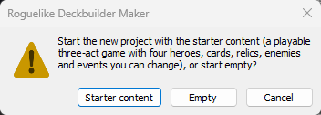
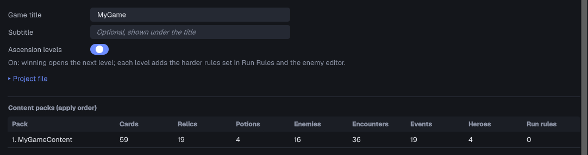
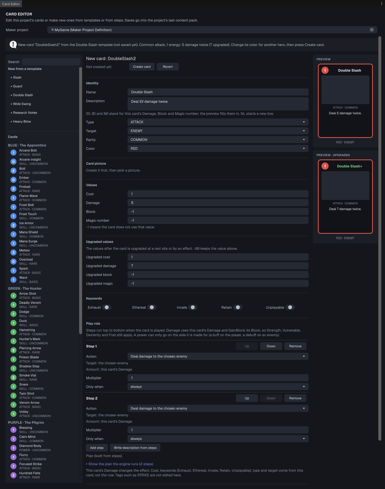
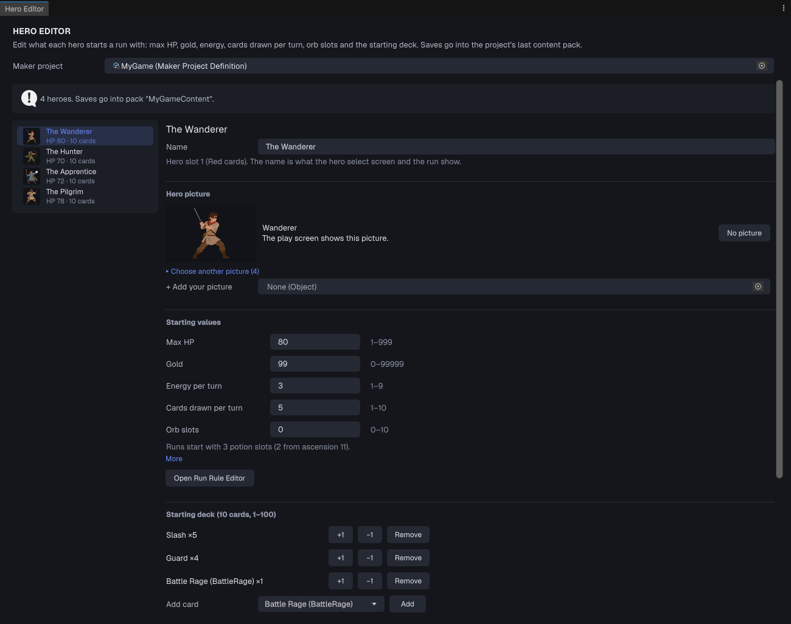
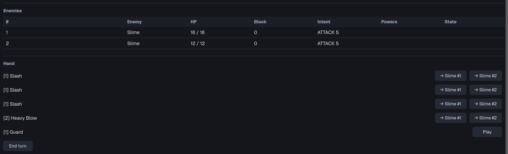

# Your first game

This walkthrough creates your own project, names the game, adds a new card, adjusts a hero and plays a run. It takes about 20 minutes.

**Menu:** **Tools > Roguelike Deckbuilder Maker > New Project...**

## 1. Create the project

1. Choose **Tools > Roguelike Deckbuilder Maker > New Project...**.
2. In the save panel **New maker project**, choose a folder of your own (for example `Assets/MyGame/`) and a file name (the default is `MyGame`). Select **Save**.
3. A dialog asks how to start. Select **Starter content**.

| Button | Result |
|---|---|
| **Starter content** | The project starts with the same playable three-act game as the sample: four heroes, cards, relics, potions, enemies, encounters and events you can change |
| **Empty** | The project starts with an empty content pack. You add every hero, card, relic, enemy, encounter and event yourself |
| **Cancel** | Nothing is created |

The command creates two assets in the folder you chose:

| Asset | What it is |
|---|---|
| `MyGame.asset` | The maker project. Its game title starts as the file name |
| `MyGameContent.asset` | The project's content pack. Editors save into it |

The project gets its own **Project ID** (the name's letters and digits plus a random suffix), so its saved runs never mix with another project's. The default art library and the default cue library are added to it.

**Project Overview** opens with the new project selected.

!!! tip
    If an asset with the same name already exists, the command refuses and asks you to choose another name.

## 2. Name the game

In **Project Overview**, under **Game**:

| Field | What to enter |
|---|---|
| **Game title** | Your game's name. The play screen's title shows it |
| **Subtitle** | An optional short line under the title. Leave it empty for none |
| **Ascension levels** | On: the title screen offers Ascension levels, and winning opens the next level. Off: every run is a plain run |
| **Unlock rules** | Keep **Maker**: every hero, card and relic is available from the start |

Each field saves when you leave it. Reopen **Game Screen** or **Player Screen** to see a new title.

See [Project Overview](../authoring/project-overview.md) for content packs and the project check.

## 3. Add a card

1. Choose **Tools > Roguelike Deckbuilder Maker > Card Editor**. The **Maker project** field shows your project.
2. In the left list, under **New from a template**, select a template such as **+ Heavy Blow**. A new, unsaved card opens. Its ID is the template's name, with a number added if that ID is taken.
3. Under **Identity**, change **Name** and **Description**. In the description, `!D!`, `!B!` and `!M!` stand for the card's Damage, Block and Magic number.
4. Set **Color** to the color of the hero who should get the card. The left list groups cards by color and shows each hero's name next to its color.
5. Under **Values**, set **Cost** and **Damage**. Under **Upgraded values**, set the values after an upgrade (`-99` keeps the value above).
6. Under **Play rule**, look at the steps. Each step is one action, for example **Deal damage to the chosen enemy**. Select **Add step** to add another, such as **Apply a power** with Weak. Select **Write description from steps** to rewrite the description from the steps.
7. Under **Card pools**, check that **In reward, shop and random-card pools** is on (a template card starts with it on). It makes the card appear in rewards and shops for heroes of its color.
8. Select **Create card**.
9. The card gets the template's default picture when it is created. To change it, open **Choose another picture** and select one from the library, or assign your own sprite to **+ Add your picture**.
10. Optional: under **Starting deck**, pick a **Hero** and select **+1** to put a copy in that hero's starting deck.

If a step is invalid, a red box under the steps explains why, and the card is not saved until you fix it. See [Cards](../authoring/cards.md).

## 4. Adjust a hero

1. Choose **Tools > Roguelike Deckbuilder Maker > Hero Editor**.
2. The left list shows four hero slots, each with its card color, for example "Hero slot 1 (Red cards)". Select a hero.
3. Change **Name**, and under **Starting values** change **Max HP**, **Gold**, **Energy per turn** or **Cards drawn per turn**.
4. Under **Starting deck**, use **+1**, **−1**, **Remove**, or **Add card** with **Add** to change the deck. The list offers the hero's color and colorless cards.
5. Select **Save**.

**Making a new hero.** In a project started with **Empty**, select an **Empty slot** and select **Create hero**. Give it a name, a starting deck and a starting relic, then **Save**. A hero needs at least one starting relic, and only relics with the tier **STARTER** can start a run; make one in the [Relic Editor](../authoring/relics.md) first if the list is empty. See [Heroes](../authoring/heroes.md).

## 5. Check the project

Open **Project Overview** and read the project check line, for example "Project check: no problems found." Select **See checks** for the list.

- **Errors** stop runs or saves. Fix them first.
- **Warnings** mean content that never appears or does nothing.
- **Notes** are for your information.

## 6. Play a run

1. Choose **Tools > Roguelike Deckbuilder Maker > Play Preview**.
2. Under **New run**, choose the **Hero**, leave **Ascension** at 0 and select **Start run**.
3. Pick rooms under **Map — choose the next room**, play cards with **Play**, and select **End turn**.
4. To check balance quickly, choose a policy in **Plays as** and select **Play to the end**, or enter a number in **Simulate runs** and select **Simulate**.

To play on the real play screen, choose **Game Screen** or **Player Screen** instead. See [Play Preview](../playtesting/play-preview.md).

## Starting from an empty project

An empty project plays only when it has, at least:

- a hero with a starting deck and a **STARTER** relic,
- cards for that hero's color in the rarities the rewards roll (COMMON, UNCOMMON, RARE),
- enemies and encounters in the weak, strong, elite and boss lists of each act,
- relics for chests, elites and the boss relic choice, and potions for potion rewards.

The project check and Play Preview tell you what is missing. Starting from **Starter content** and replacing it piece by piece is usually faster.

## Related pages

[Projects and content](../concepts/projects-and-content.md) · [Project Overview](../authoring/project-overview.md) · [Cards](../authoring/cards.md) · [Heroes](../authoring/heroes.md) · [Play Preview](../playtesting/play-preview.md)
