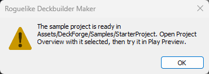
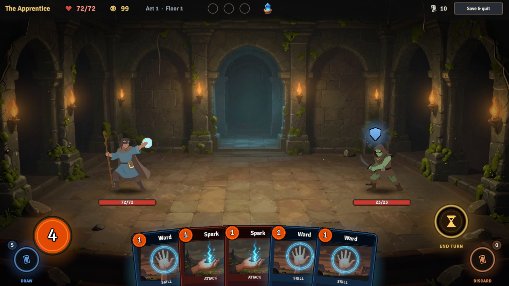

# Sample project

The sample project is a complete, playable three-act game made only with the maker's editors and default pictures. Use it to see how content fits together and to try the playtesting tools before you build your own game.

**Menu:** **Tools > Roguelike Deckbuilder Maker > Create Sample Project**

## Create the sample

1. Choose **Tools > Roguelike Deckbuilder Maker > Create Sample Project**.
2. Wait for the dialog: "The sample project is ready in Assets/DeckForge/Samples/StarterProject. Open Project Overview with it selected, then try it in Play Preview." Select **OK**.
3. The project asset is selected and highlighted in the Project window.
4. Choose **Tools > Roguelike Deckbuilder Maker > Project Overview**. The window picks up the selected project in its **Maker project** field.

Running the command again rewrites the sample's content in place and keeps its asset files. Anything you changed in the sample is replaced.

## What it creates

Two assets in `Assets/DeckForge/Samples/StarterProject/`:

| Asset | Type | Contents |
|---|---|---|
| `StarterProject.asset` | Maker project | Game title "Starter Citadel", subtitle "Sample", the content pack below, the default art library and the default cue library |
| `StarterContent.asset` | Content pack | Every hero, card, relic, potion, enemy, encounter and event of the sample, with their picture choices |

The content of the sample:

| Content | In the sample |
|---|---|
| Heroes | 4: The Wanderer, The Hunter, The Apprentice and The Pilgrim, one in each hero slot. Each starts with 99 gold, 3 energy, 5 cards drawn per turn, a 10-card deck (five basic attacks, four basic blocks and one signature card) and one starting relic |
| Cards | 59, about 15 per hero, using the hero's card color. The Wanderer fights with Block and Strength, the Hunter with Poison and Weak, the Apprentice with area damage and energy, the Pilgrim with Block, healing and Strength |
| Relics | 18: four starting relics, common, uncommon, rare and shop relics, and six boss relics |
| Potions | 3: a healing potion usable outside combat, a Block potion and an area damage potion |
| Enemies | 16 across three acts, each with its own picture and a move cycle |
| Encounters | Weak, strong, elite and boss lists for each act. The bosses are Fire Dragon (act 1), Lich King (act 2) and Sea Kraken (act 3) |
| Events | 4 per act: three ordinary events and one shrine. One ordinary event can lead into a fight |
| Pictures | Hero, card, relic, enemy and event pictures and one battle background per act, all from the default art library |

The sample uses the **Maker** unlock rules (everything is available from the start) and has no custom rule modules.

## Play the sample

**In Play Preview** (fast, text-based):

1. Choose **Tools > Roguelike Deckbuilder Maker > Play Preview**.
2. Check that **Maker project** is the sample, pick a hero and select **Start run**.
3. Play by hand, or use **Test player** buttons such as **Play to the end**.

**On the play screen**:

1. Choose **Tools > Roguelike Deckbuilder Maker > Game Screen** or **Player Screen**.
2. The title screen shows "Starter Citadel". Start a new run and play with the mouse.

See [Play Preview](../playtesting/play-preview.md), [Game Screen](../playtesting/game-screen.md) and [Player Screen and your build](../playtesting/player-screen.md).

## Explore the content

Open any editor with the sample selected to see how it is built:

- **Card Editor**: cards grouped by color, each with play steps such as "Deal damage to the chosen enemy" and "Apply a power".
- **Relic Editor**: relics with triggers such as "At the start of each combat".
- **Enemy Editor**: moves with intents and AI rules that cycle through them.
- **Encounter Editor**: the fight lists of each act.
- **Event Editor**: pages, choices and outcomes.

## Build on the sample

Do not edit the sample to make your game: **Create Sample Project** overwrites it. Instead, choose **Tools > Roguelike Deckbuilder Maker > New Project...** and select **Starter content**. You get the same content in your own folder, under a new project ID. See [Your first game](first-game.md).

## Check your result

- **Project Overview** with the sample shows one content pack, "StarterContent", with its card, relic, potion, enemy, encounter, event and hero counts.
- The project check line shows no errors.
- **Play Preview** starts a run with each of the four heroes.

## Related pages

[Installation](installation.md) · [Your first game](first-game.md) · [Projects and content](../concepts/projects-and-content.md) · [Play Preview](../playtesting/play-preview.md)
