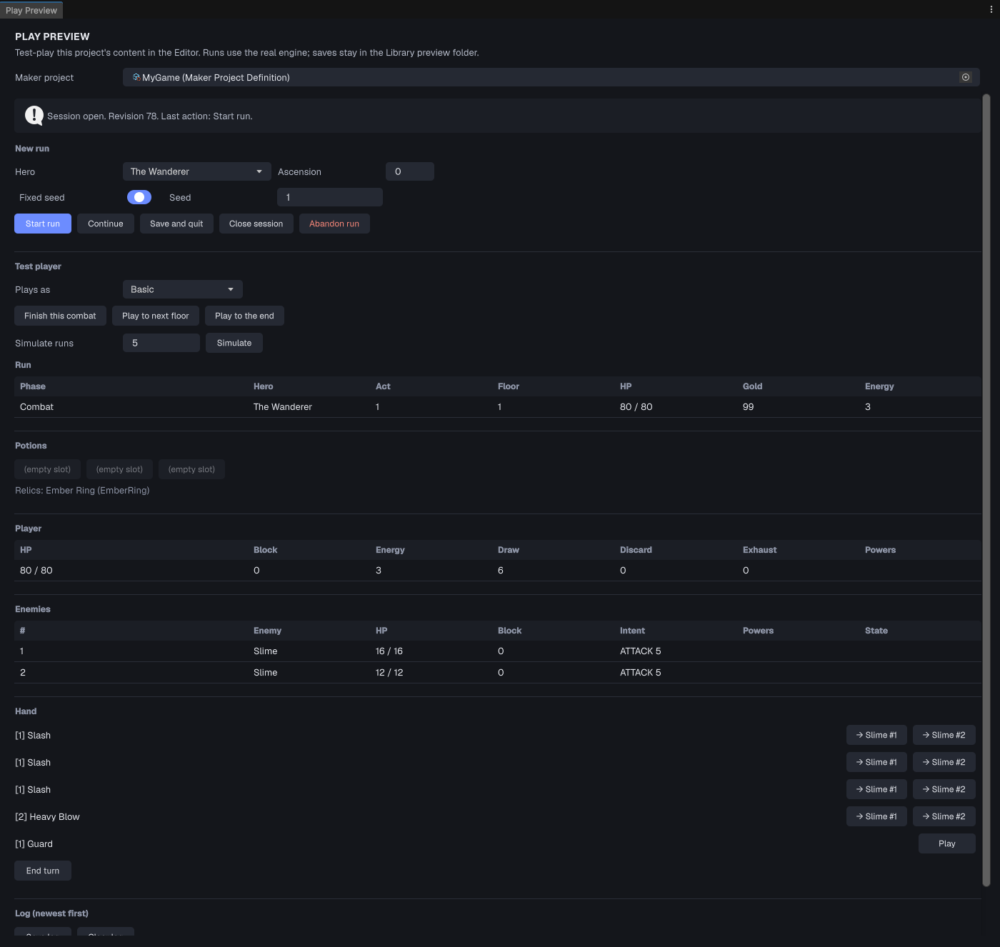
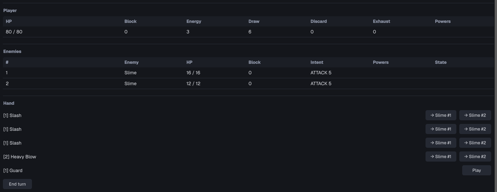
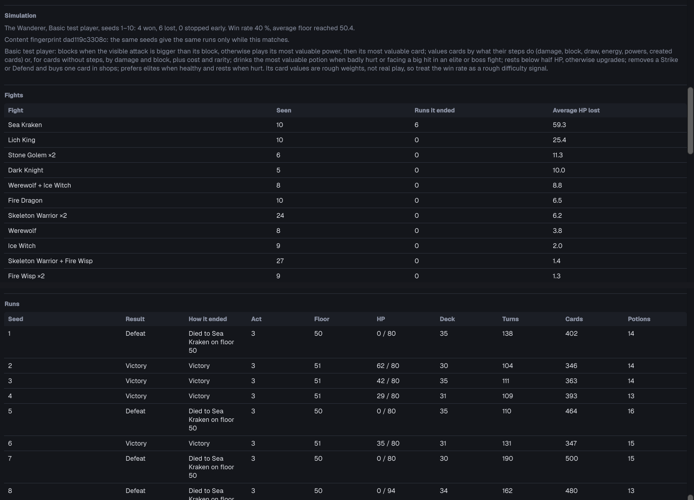

# Play Preview

Play Preview test-plays your project inside the Unity Editor without entering Play mode. It runs the real engine over your project's content, lets you play a run step by step with plain buttons, lets a test player play for you, and simulates many runs to show where your game is too hard, too easy or breaks.

Open it from **Tools > Roguelike Deckbuilder Maker > Play Preview**.

## Choose the project

The **Maker project** field at the top picks the project to play. When the window opens it uses the project selected in the Project window, otherwise the first project it finds. Changing the project closes the open session.

## New run

| Control | What it does |
|---|---|
| **Hero** | The hero to play. The list shows the project's hero names. |
| **Ascension** | Ascension level from 0 to 20. Used by **Start run** and **Simulate**. |
| **Fixed seed** | On: the run uses the **Seed** value, so the same seed gives the same run. Off: the engine picks a random seed. |
| **Seed** | The seed for **Start run**, and the first seed for **Simulate**. |
| **Start run** | Opens a session and starts a new run with the chosen hero. Refused while a run is active. |
| **Continue** | Resumes the saved preview run of the chosen hero. See [Saves and continue](saves-continue.md). |
| **Save and quit** | Leaves the active run. The run continues later from its last checkpoint. |
| **Close session** | Closes the session. The saved run stays on disk. |
| **Abandon run** | Ends the run of the chosen hero and deletes its save. |

The status line under the header says whether a session is open and names the last action. Refusals from the engine (for example a card that cannot be played) appear there with the engine's own reason.

## Playing by hand

While a run is active, the window shows the current screen as tables and buttons:

- **Run**: phase, hero, act, floor, HP, gold and energy, followed by your potions and relics.
- **Map — choose the next room**: one button per room you can enter.
- Combat: **Player** and **Enemies** tables (HP, block, intent, powers), the **Hand** with **Play** buttons (one button per enemy for targeted cards) and **End turn**.
- **Rewards**, **Shop**, event pages, **Rest site** and card selections, each with the buttons the engine offers (**Claim**, **Buy**, **Remove a card**, **Skip remaining rewards**, **Leave room**, **Confirm** and so on).

A card that cannot be played shows the engine's reason next to it. A potion button is disabled with a tooltip when it cannot be used.

## Test player

The test player plays the open run for you. **Plays as** chooses how it plays:

| Policy | Behaviour |
|---|---|
| **Basic** | Blocks when the visible attack is bigger than its block, otherwise plays its most valuable cards. Scores card rewards, drinks potions when badly hurt, rests below half HP and otherwise upgrades, removes a basic card and buys one card in shops, prefers elites when healthy. |
| **Smoke** | Takes the first option everywhere: first playable card, first room, first card reward, leaves shops. It finds content that breaks or stalls, not how strong a deck is. |

| Button | Plays until |
|---|---|
| **Finish this combat** | The current combat ends. |
| **Play to next floor** | The map of a later floor is reached. |
| **Play to the end** | The run ends, the engine stops it, or the move limit is reached. |

Every move the test player makes is written to the log, with refused moves marked.

## Simulate runs

**Simulate runs** (1 to 50) and **Simulate** play that many fresh runs of the chosen hero with the chosen test player, using seeds **Seed**, **Seed**+1, and so on. Each simulated run uses its own temporary save folder, so your preview run and its save are not touched. A progress bar shows the current run; **Cancel** skips the remaining seeds and keeps the runs already played. The Editor is busy until the simulation finishes.

The summary starts with the win rate and the average floor reached, and the content fingerprint. The same seeds give the same runs only while the fingerprint stays the same. The tables below it are:

| Table | Shows |
|---|---|
| **Fights** | Each fight: how often it was seen, how many runs it ended, average HP lost. Sorted by the fights that ended the most runs. |
| **Enemies made in the maker** | Per enemy: runs it fought in, summons, splits, deaths and revivals, phase changes, escapes, gold stolen and returned. |
| **Where runs got stuck** | Runs that stopped without winning or losing, with the reason. |
| **Checkpoints not saved** | Runs whose checkpoint could not be written. |
| **Runs** | One row per seed: result, how it ended, act, floor, HP, deck size, turns, cards played, potions used. |
| **Cards**, **Relics**, **Potions**, **Powers** | How often each was offered, picked, bought, played, used or fired, and how far runs that ended with it got. |
| **Events** | Runs each event opened in, pages reached, greyed-out choices skipped, and the choices picked on pages. |

The test player's card values are rough weights, not real play. Treat the win rate as a rough difficulty signal and compare it between versions of your content.

## Log

**Log (newest first)** lists the last 40 commands with the floor and HP at that point. **Save log** writes the whole log (up to 500 entries) to a text file in `Library/DeckForgeMakerPreview/Logs`. **Clear log** empties it.

## Where Play Preview saves

Play Preview saves under `Library/DeckForgeMakerPreview` in your Unity project, in a folder for the project's ID. It never writes to the play screen's saves. Play Preview shows the result of a finished run but does not record end-of-run progress such as opened ascension levels.

## Workflow

1. Select your project and open Play Preview.
2. Choose a hero, keep **Fixed seed** on and press **Start run**.
3. Play the first combat by hand to check your cards, then press **Play to the end**.
4. Set **Simulate runs** to 20 and press **Simulate**. Look at **Fights** and **Runs** for fights that end too many runs.
5. Change content in the editors and simulate the same seeds again to compare.

## Check your result

- The status line says **Session open** after **Start run**, with no error below it.
- **Where runs got stuck** is empty. A run stuck in an event usually means a page whose choices can all be greyed out at once.
- The project check on [Project Overview](../authoring/project-overview.md) shows no errors.

## Related pages

- [Game Screen](game-screen.md)
- [Saves and continue](saves-continue.md)
- [Run flow](../concepts/run-flow.md)
- [Troubleshooting](../help/troubleshooting.md)
