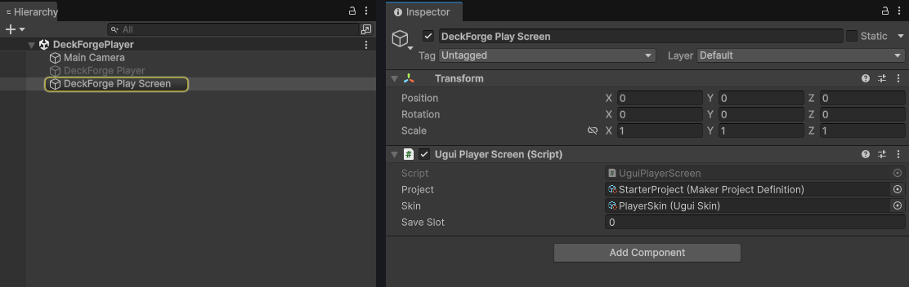
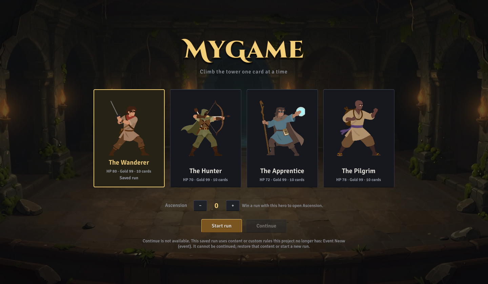

# Player Screen and your build

The package ships a ready play screen for your game. It reads your project's content, shows your **Game title** and **Subtitle** on the title screen, and keeps saves per project. This page explains the play screen scene, how to use the screen in your own scene and build, the **Player Screen** window, and the **Rebuild Play Screen Skin** command.

## The play screen

The release play screen is built with uGUI and TextMesh Pro. It covers the title screen (hero choice, ascension level, **Start** and **Continue**), the map, combat, rewards, treasure, shops, rest sites, events, card selections, the deck and pile lists, and the run's ending.

Its files are in `Assets/DeckForge/Player`:

| Path | Contents |
|---|---|
| `Player/Scenes/DeckForgePlayer.unity` | A ready scene with the play screen. Its project is the sample project. |
| `Player/Ugui/UguiPlayerScreen.cs` | The component that runs the uGUI play screen. |
| `Player/Ugui/PlayerSkin.asset` | The skin: frame and icon sprites and the fonts. |
| `Player/Ugui/Skin`, `Player/Ugui/Fonts` | The skin's sprites and TextMesh Pro font assets. |
| `Player/DeckForgePlayer.cs`, `Player/UI` | A second play screen built with UI Toolkit, shown by the Player Screen window. It is turned off in the scene. |

## The title shows your game

The title screen shows the project's **Game title** in large letters and the **Subtitle** under it. Set both on [Project Overview](../authoring/project-overview.md). A project with an empty title shows "Untitled", and an empty subtitle shows no line. When **Ascension levels** is off on Project Overview, the title shows no Ascension row.

## Use the play screen in your own scene

1. Open `Player/Scenes/DeckForgePlayer.unity`, or create a scene with a camera.
2. Select the **DeckForge Play Screen** object, or add an empty GameObject and add the **Ugui Player Screen** component (`UguiPlayerScreen`).
3. Fill in its fields:

    | Field | Value |
    |---|---|
    | **Project** | Your project asset (`MakerProjectDefinition`). |
    | **Skin** | `Assets/DeckForge/Player/Ugui/PlayerSkin.asset`. |
    | **Save Slot** | The save slot inside the project's save folder. Leave it at 0 unless you need separate save slots. |

4. Enter Play mode to try it, or add the scene to your build's scene list.

The component creates its own canvas (1920×1080 reference resolution, scaled to the screen height). If the scene has no event system, it creates one with the Input System UI input module. If **Project** or **Skin** is empty, it logs "Roguelike Deckbuilder Maker: assign the project and the skin to the play screen." and shows nothing.

## Saves in a built game

A built game saves under `Application.persistentDataPath/DeckForge/<Project ID>`, one folder per project, so two games made with the maker never share a save. The Project ID is shown on Project Overview under **Project file**. Do not give two projects the same ID; Project Overview warns when they share one. See [Saves and continue](saves-continue.md).

## The Player Screen window

**Tools > Roguelike Deckbuilder Maker > Player Screen** shows the UI Toolkit play screen (`DeckForgePlayerView`) inside an Editor window without Play mode. It uses the same session, saves and rules as the uGUI screen, with a simpler look. Its saves go to `Library/DeckForgePlayerScreen`, shared with the [Game Screen](game-screen.md) window.

The window uses the project that was selected when it was first opened. To change the project, close the window, select the other project and open it again. The window's minimum size is 1100×720.

To check what your players will see, use [Game Screen](game-screen.md), which shows the uGUI screen of your build.

## Rebuild Play Screen Skin

**Tools > Roguelike Deckbuilder Maker > Rebuild Play Screen Skin** re-imports the sprites in `Player/Ugui/Skin`, creates any missing TextMesh Pro font assets in `Player/Ugui/Fonts`, and writes `PlayerSkin.asset`. Existing font assets are kept. The Game Screen window runs it on its own when `PlayerSkin.asset` is missing. It writes a one-line result to the Console.

!!! note
    The command sets the import settings of every sprite in `Player/Ugui/Skin` again and keeps each sprite's nine-slice border. Run it when `PlayerSkin.asset` is missing or broken, and check the frames on the Game Screen afterwards.

## Text and fonts

The play screen text uses TextMesh Pro. The first time the Editor opens the project, the maker imports TextMesh Pro's essential resources if they are missing, without a dialog. The fonts are Signika for game text, Cinzel Decorative for the title and Pretendard as the fallback for Korean characters.

## Check your result

- In Play mode, the title screen shows your **Game title** and your heroes.
- Starting a run, saving with **Save & quit** and pressing **Continue** brings you back to the same run.
- The play screen in Play mode and the Game Screen window look the same.

## Related pages

- [Game Screen](game-screen.md)
- [Saves and continue](saves-continue.md)
- [Project Overview](../authoring/project-overview.md)
- [Art library](../authoring/art-library.md)
- [Sound and effects](../authoring/sound-effects.md)
